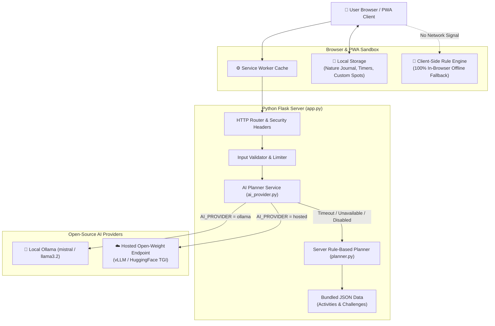

# 🌿 TrailBuddy Offline — AI-Powered Outdoor Companion

> **“Less scrolling. More exploring.”**  
> An open-source, privacy-first Progressive Web App built for **Hacktoberfest 2026 (Week 1: “Touch Grass”)**.

[](https://opensource.org/licenses/MIT)
[](https://www.python.org/)
[](#offline-and-pwa-architecture)
[](#open-source-ai-integration)
[](#running-tests)

---

## 📖 Table of Contents

1. [Overview & Challenge Relevance](#overview--challenge-relevance)
2. [Problem Statement & Impact](#problem-statement--impact)
3. [Architecture Overview](#architecture-overview)
4. [Key Features](#key-features)
5. [Open-Source AI Integration](#open-source-ai-integration)
6. [Offline & PWA Architecture](#offline--pwa-architecture)
7. [Local Quickstart (Windows, macOS, Linux)](#local-quickstart)
8. [Connecting an Open-Source Model (Ollama)](#connecting-an-open-source-model-ollama)
9. [Configuration & Environment Variables](#configuration--environment-variables)
10. [Render Deployment Guide](#render-deployment-guide)
11. [Running Tests](#running-tests)
12. [Privacy & Security Guarantee](#privacy--security-guarantee)
13. [Known Limitations & Design Boundaries](#known-limitations--design-boundaries)
14. [Contributing](#contributing)
15. [License & Model Licensing](#license--model-licensing)

---

## 🌟 Overview & Challenge Relevance

Modern software is engineered to maximize "time on screen" — weaponizing push notifications and infinite algorithmic feeds. **TrailBuddy Offline** turns this paradigm inside out.

Built for the **Hacktoberfest 2026 Week 1 Challenge: “Touch Grass”**, TrailBuddy's primary measure of success is helping users **put their devices down** and step into natural spaces. It pairs open-weight language models with a progressive web app to generate personalized, sensory-rich outdoor itineraries, track screen-free outdoor time, offer daily grounding challenges, and preserve private nature reflections without any cloud data harvesting.

---

## 🎯 Problem Statement & Impact

- **Digital Exhaustion:** Modern adults spend an average of 7+ hours per day staring at illuminated pixels, causing sensory fatigue and reduced nature connection.
- **Overcomplicated Planning:** Exploring the outdoors often feels intimidating or requires paid trail apps and invasive location tracking.
- **Connectivity Dead Zones:** The best natural spaces are often dead zones with zero cellular signal. Most web apps fail completely without internet access.
- **Privacy Intrusion:** Outdoor apps frequently demand account creation, GPS tracking, and monetization of personal wellness logs.

**The TrailBuddy Solution:**
- **Zero Accounts:** Works immediately without registration, logins, or tracking cookies.
- **Offline-First:** Caches application assets and runs a deterministic rule-based generator right in the browser when network connectivity drops.
- **Open-Source AI:** Uses open-weight models (Ollama / Mistral / Llama) for creative generation with transparent fallbacks.
- **Zero Cloud Leakage:** Nature journal entries and timers are stored 100% on the user's device.

---

## 🏗️ Architecture Overview

The following diagram illustrates the resilient offline-first and AI architecture:



---

## 💎 Key Features

### 1. Home Dashboard & Screen-Free Timer
- Nature-inspired visual palette (forest green, warm cream, muted sage, earthy terracotta).
- Interactive screen-free session stopwatch to track real-world minutes spent outside.
- Real-time streaks, completed challenge tallies, and nature observation counts.
- Dynamic network status pill reflecting online/offline state.

### 2. Personalized Outdoor Planner
- Collects:
  - **Available time:** 15m (Micro), 30m, 1h, 2h, half a day.
  - **Activity:** Walking, hiking, birdwatching, gardening, photography, cycling, stargazing, relaxation.
  - **Energy level:** Low, moderate, high.
  - **Budget:** Free ($0), low-cost, flexible.
  - **Environment:** Public park, forest, garden, beach, countryside, indoor nature.
  - **Accessibility:** Wheelchair-accessible, paved trails, seated options, low-impact, sensory-friendly.
- Synthesizes 9 structured fields:
  1. Activity title & duration
  2. Step-by-step itinerary with interactive checkboxes
  3. Household equipment list
  4. Estimated budget
  5. Mindful nature observation task
  6. Screen-free recommendation tip
  7. Safety & weather checklist
  8. Reflection prompt
  9. Weather & local condition disclaimer
- Displays a visible badge stating whether the plan was **AI-Generated** or produced by the **Offline Fallback Engine**.

### 3. Private Nature Journal
- Fully private observation log stored in browser storage.
- Records title, notes, date, location tag, habitat category, and nature mood.
- Instant search and environment filtering.
- One-click **JSON Backup Export** (`trailbuddy-nature-journal-YYYY-MM-DD.json`) and **JSON Restore**.
- One-click transfer from generated outdoor plan reflections directly into a journal draft.

### 4. Touch Grass Challenge Curriculum
- 10 bundled, original outdoor challenges (Soundscape Symphony, Leaf Scavenger, Screen-Free Mile, Macro Textures, Dusk Vigil, etc.).
- Categorized by Mindfulness, Biodiversity, Active, Creative, and Micro-Adventures.
- Daily challenge spotlight rotated deterministically by day of the year.
- Explicit user confirmation required to complete (no fake completions).

### 5. Local Discovery & User Spots
- Curated sample activity ideas with demonstration locations.
- Clear disclaimer that demonstration locations are sample ideas.
- Personal spot saver: allows users to record and manage their own favorite nearby benches and trails locally.

---

## 🤖 Open-Source AI Integration

TrailBuddy treats open-source AI as a genuine, functional capability while respecting physical computing constraints:

### Four Operational Modes Clarified

| Level | Where Code Runs | Internet Needed? | AI Model Used |
| :--- | :--- | :--- | :--- |
| **1. Local Ollama AI** | Local machine / localhost | **No** (after model download) | Local open-weight (`mistral`, `llama3.2`) |
| **2. Hosted Open-Weight** | Remote inference server | **Yes** | Remote open-weight (vLLM, TGI, Together) |
| **3. Server Rule Engine** | Flask backend (`planner.py`) | **No** | Deterministic heuristics & JSON templates |
| **4. In-Browser Engine** | User's browser JS (`offline.js`)| **No** (standalone PWA) | Bundled client-side matching algorithm |

### Guardrails Against AI Hallucination
- System prompt strictly forbids fabricating current weather, opening hours, live closures, or GPS coordinates.
- Output validation enforces complete JSON schemas with lists, strings, and safety warnings.
- Server timeout (default: 8.0s) prevents slow models from blocking users.
- On failure (timeout, bad JSON, unreachable service), the system automatically returns a tailored rule-based plan with a friendly notice.

---

## 📴 Offline & PWA Architecture

1. **Service Worker (`service-worker.js`):**
   - Pre-caches application shell: HTML, CSS, JavaScript, icons, Web App Manifest, and JSON catalogs.
   - Cache-First strategy for static assets.
   - Network-First with Cache fallback for navigation routes.
   - Dedicated fallback page at `/offline.html`.
   - **Never caches stale AI plans:** `/api/plan` is network-only; if network fails, client-side JavaScript instantly invokes the in-browser rule engine.
2. **Web App Manifest (`manifest.json`):**
   - Configures standalone display mode, theme colors (`#1b4332`), responsive icons, and direct quick-launch shortcuts.
3. **First-Load Requirement:**
   - The application must be loaded online once so that the browser can register the service worker and download shell assets into the Cache Storage API.

---

## 🚀 Local Quickstart

### Prerequisites
- Python 3.10, 3.11, 3.12, or 3.13 installed.
- Git installed.

### Steps on Windows (PowerShell)

```powershell
# 1. Clone repository
git clone https://github.com/paiikarthik/TrailBuddy-Offline.git
cd TrailBuddy-Offline

# 2. Create and activate a virtual environment
python -m venv .venv
.\.venv\Scripts\Activate.ps1

# 3. Install dependencies
pip install -r requirements.txt

# 4. Copy environment configuration
Copy-Item .env.example .env

# 5. Run development server
python app.py
```

Open your browser to: **`http://localhost:5000`**

---

## 🦙 Connecting an Open-Source Model (Ollama)

TrailBuddy is pre-configured to use **Ollama** out of the box on `http://localhost:11434`.

1. Download and install Ollama from [ollama.com](https://ollama.com).
2. Pull an open-weight model:
   ```bash
   ollama pull mistral
   # or a lightweight model suitable for laptops with 8GB RAM:
   ollama pull llama3.2
   ```
3. Verify Ollama is running:
   ```bash
   curl http://localhost:11434/api/version
   ```
4. In your `.env` file, ensure:
   ```ini
   AI_PROVIDER=ollama
   OLLAMA_BASE_URL=http://localhost:11434
   OLLAMA_MODEL=mistral
   ```
5. Generate an adventure plan in TrailBuddy. You will see the badge:  
   `✨ AI-Generated (Ollama (mistral))`

---

## ⚙️ Configuration & Environment Variables

All settings can be configured via environment variables or a `.env` file:

| Variable | Default | Description |
| :--- | :--- | :--- |
| `PORT` | `5000` | Port for the web server to bind to. |
| `FLASK_DEBUG` | `0` | Set to `1` for interactive local debugging. |
| `AI_PROVIDER` | `ollama` | Provider: `ollama`, `hosted`, or `disabled`. |
| `OLLAMA_BASE_URL` | `http://localhost:11434` | Endpoint for local Ollama server. |
| `OLLAMA_MODEL` | `mistral` | Model name installed in Ollama. |
| `HOSTED_AI_ENDPOINT` | `""` | URL for external OpenAI-compatible open-weight endpoint. |
| `HOSTED_AI_MODEL` | `mistralai/Mistral-7B-Instruct-v0.3` | Model identifier for hosted endpoint. |
| `HOSTED_AI_KEY` | `""` | Bearer token for hosted API (server-side only). |
| `AI_TIMEOUT_SECONDS`| `8.0` | Maximum seconds to wait for AI inference before fallback. |
| `RATE_LIMIT_PER_MINUTE` | `60 per minute` | In-memory IP rate limit expression for endpoints. |

---

## ☁️ Render Deployment Guide

TrailBuddy includes a production-ready `render.yaml` Blueprint for Render Web Services.

### Key Considerations for Render Free Tier
- **Container Memory:** Render free tier provides 512MB RAM. Running large language models directly inside the container is not feasible.
- **Default Behavior:** `render.yaml` sets `AI_PROVIDER: disabled` by default, ensuring the app boots immediately, consumes minimal memory (~50MB), and serves instant plans via the offline rule-based engine.
- **Connecting Remote Open-Weight AI:** If you wish to enable AI on Render, configure `AI_PROVIDER: hosted` and supply a `HOSTED_AI_ENDPOINT` (e.g. HuggingFace Inference Endpoint or vLLM).

### Deploying via Blueprint
1. Push your repository to GitHub.
2. In the [Render Dashboard](https://dashboard.render.com), click **New +** -> **Blueprint**.
3. Connect your GitHub repository.
4. Render will parse `render.yaml` and configure:
   - **Build Command:** `pip install -r requirements.txt`
   - **Start Command:** `gunicorn app:app --bind 0.0.0.0:$PORT --workers 2 --threads 4 --timeout 60`
   - **Health Check Path:** `/health`
5. Click **Apply**. Once built, your live application will be accessible at your Render `.onrender.com` URL.

---

## 🧪 Running Tests

TrailBuddy includes 23 automated tests covering routes, health checks, input validation boundaries, duration scaling, accessibility adaptations, and AI timeout/failure fallbacks.

Run the test suite with pytest:

```bash
python -m pytest -v
```

Expected output:
```text
tests/test_planner.py::test_activities_dataset_loads PASSED              [  4%]
tests/test_planner.py::test_rule_based_plan_required_fields PASSED       [  8%]
tests/test_planner.py::test_duration_adaptation PASSED                   [ 13%]
tests/test_planner.py::test_accessibility_adaptation PASSED              [ 17%]
tests/test_planner.py::test_rule_based_endpoint PASSED                   [ 21%]
tests/test_routes.py::test_home_page PASSED                              [ 26%]
tests/test_routes.py::test_health_endpoint PASSED                        [ 30%]
tests/test_routes.py::test_api_status PASSED                             [ 34%]
tests/test_routes.py::test_api_activities PASSED                         [ 39%]
tests/test_routes.py::test_api_challenges PASSED                         [ 43%]
tests/test_routes.py::test_manifest_serving PASSED                       [ 47%]
tests/test_routes.py::test_service_worker_serving PASSED                 [ 52%]
tests/test_routes.py::test_offline_page PASSED                           [ 56%]
tests/test_routes.py::test_security_headers PASSED                       [ 60%]
tests/test_validation.py::test_invalid_time_available PASSED             [ 65%]
tests/test_validation.py::test_invalid_activity_type PASSED              [ 69%]
tests/test_validation.py::test_invalid_energy_level PASSED               [ 73%]
tests/test_validation.py::test_invalid_environment PASSED                [ 78%]
tests/test_validation.py::test_non_json_request PASSED                   [ 82%]
tests/test_validation.py::test_ai_timeout_falls_back_gracefully PASSED   [ 86%]
tests/test_validation.py::test_ai_connection_refused_falls_back PASSED   [ 91%]
tests/test_validation.py::test_ai_malformed_json_falls_back PASSED       [ 95%]
tests/test_validation.py::test_ai_valid_response_succeeds PASSED         [100%]

============================= 23 passed in 12.57s =============================
```

---

## 🔒 Privacy & Security Guarantee

- **Zero Tracking:** No analytics libraries, third-party tracking beacons, or cookies are included.
- **Client Storage:** Nature journal entries, screen-free timer sessions, and personal spots are stored exclusively in the browser's `localStorage`. They are never sent to the Flask backend or logged to files.
- **Hardened HTTP Headers:** Every response delivers `X-Content-Type-Options: nosniff`, `X-Frame-Options: SAMEORIGIN`, `Referrer-Policy: strict-origin-when-cross-origin`, and restrictive `Content-Security-Policy`.
- **Credential Hygiene:** API tokens for hosted providers are kept server-side in `.env` and are never exposed to browser JavaScript.

---

## ⚠️ Known Limitations & Design Boundaries

1. **First-Load Network Requirement:** As with all Progressive Web Apps, the browser must connect online at least once to cache the application shell before offline operation is possible.
2. **Browser Storage Eviction:** If a user explicitly clears website cookies and storage data, local journal entries will be deleted. Users are reminded to use the built-in **Export JSON Backup** feature.
3. **No Live Condition Data:** TrailBuddy intentionally avoids scraping or inventing live weather, opening hours, or trail conditions. Users must independently verify local rules.

---

## 📸 Screenshots & UI Capture Guide

To capture screenshots for your submission:
1. Start the application locally via `python app.py`.
2. Open `http://localhost:5000` in Google Chrome or Firefox.
3. Use Developer Tools (F12) Device Mode to capture mobile layouts (e.g. iPhone 14, Pixel 7).
4. Save images to `docs/screenshots/`:
   - `dashboard.png` — Main dashboard showing the screen-free timer and daily challenge.
   - `planner_result.png` — Generated adventure plan with the AI source badge.
   - `journal.png` — Private nature journal with filters and export buttons.
   - `challenges.png` — Touch Grass challenges grid and modal dialog.

---

## 🤝 Contributing

Contributions are welcome! Please follow these steps:
1. Fork the repository.
2. Create a feature branch: `git checkout -b feature/mindful-challenge`.
3. Add your challenge to `data/challenges.json` or improve planning heuristics in `services/planner.py`.
4. Ensure all tests pass: `python -m pytest`.
5. Open a Pull Request with a clear description of your changes.

---

## 📄 License & Model Licensing

- **Application Code:** Licensed under the [MIT License](LICENSE).
- **Open-Weight AI Models:** Models used with TrailBuddy (e.g., Mistral 7B under Apache 2.0, Meta Llama 3.2 under Llama Community License) are governed by their respective licenses. TrailBuddy does not distribute model weights directly.
